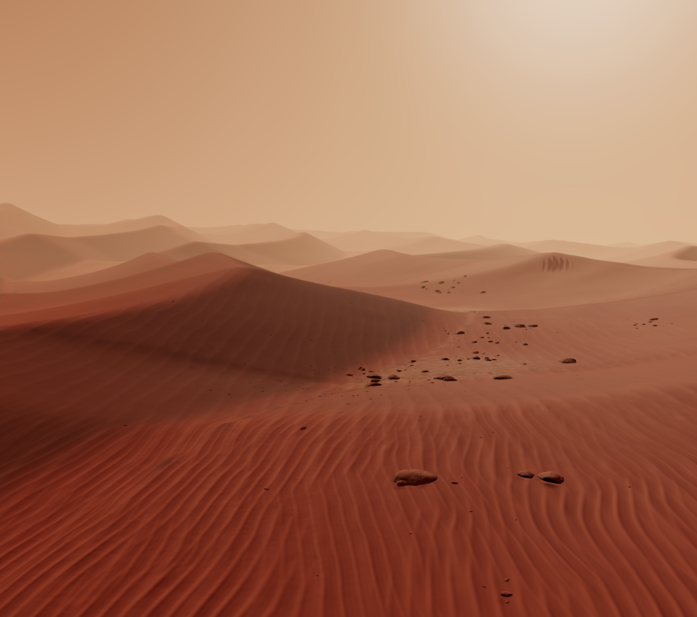

# Dune terrain simulation (Three.js WebGPU / WebGL)



Real-time 3D simulation of Gale Crater and the Bagnold Dunes built with Three.js (`three/webgpu` and TSL node shaders), Vite, and `pnpm`. Every mesh, ripple normal, rock fracture, and atmospheric scattering gradient is generated mathematically in code with zero external models, textures, or HDRIs.

## Architecture

- `src/main.js` initializes `THREE.WebGPURenderer` with automatic fallback to WebGL2 (`forceWebGL: true`), manages the directional sunlight and shadow frustum, drives the six camera presets, and handles keyboard-only teleoperation and the `TAB`-toggled Mastcam-Z digital telemetry HUD.
- `src/noise.js` implements a deterministic 32-bit PRNG (`mulberry32`), 2D/3D gradient-value noise, rotated multi-octave FBM, ridged multifractal noise, polynomial smooth-min/max (`smin`/`smax`), and the $C^1$-continuous asymmetric barchan dune profile.
- `src/terrain.js` builds a radially warped `560x560` terrain mesh (`627,200` triangles) and attaches a custom TSL `MeshStandardNodeMaterial` with finite-difference normal perturbation, multi-scale aeolian ripple fields, and post-lighting aerial perspective.
- `src/rocks.js` sculpts three indexed rock archetypes using 9 random fracture planes with beveled edges and places `1,920` instances across `65` geological float clusters via `THREE.InstancedMesh`.
- `src/sky.js` provides a shared TSL atmospheric radiance function (`evalDuneAtmosphereRadiance`) used by both the sky dome and the terrain/rock post-lighting fog pass.

## Procedural terrain generation

The macro heightfield (`sampleDuneGeology` in `src/noise.js`) combines four spatial scales:

1. Primary and oblique barchanoid dune trains (`evaluateBarchanDune`) with gentle windward ramps (`p < 0.68`), polynomial smooth-min rounded brinks (`k = 0.18`), and `31°` leeward avalanche slip-faces (`p ∈ [0.68, 0.98]`).
2. Regional Murray/Stimson interdune bedrock exposures (`bedrockExposure`) forming low-relief flat rocky pavements (`±1.4m`) where wind has scoured away the active sand cover.
3. Wind-carved yardang ridges (`ridged2D`) aligned with the prevailing wind vector.
4. Distant stratified crater-rim mesas and buttes (`rimStart` from `185m` to `520m`) capped with smooth plateau profiles (`smin`).

## Custom TSL shader techniques

All shaders are authored in Three.js Shading Language (`three/tsl`) so a single node graph compiles to both WGSL (WebGPU) and GLSL (WebGL2):

- **Clamped polynomial ripple cascade (`evalRippleWaveField`):** Combines `4.65m` meso-undulations, `1.85m` megaripples, `0.68m` primary impact ripples with FBM-driven Y-junction bifurcations, and `0.22m` cross-wind trough ripples. Wave profiles use clamped cubic polynomials (`u * u * (1.4 - 0.4 * u)`) rather than fractional `pow()` calls to avoid `NaN` on negative wave phases in WGSL.
- **Distance-adaptive finite-difference normals (`material.normalNode`):** Samples `evalFineSurfaceHeight` at `(x, z)`, `(x + eps, z)`, and `(x, z + eps)` where `eps` scales with camera distance (`0.025m` to `0.30m`), suppressing high-frequency ripples on steep slopes (`slopeSuppression`) to prevent grazing-angle normal inversion.
- **Geological sorting (`material.colorNode`):** Blends oxidized ferric dust (`#b35731`, `#c97b4d`), dark mafic basaltic sand (`#523428`, `#6b4130`) sorted onto leeward slip-faces, and buff/sienna bedrock outcrops (`#b57952`, `#8c4f32`).
- **Post-lighting atmospheric scattering (`material.outputNode`):** Applies optical depth and Henyey-Greenstein forward dust scattering after PBR lighting so distant mesas fade smoothly into the salmon-butterscotch horizon at any solar elevation (`4°` to `85°`).

## Controls and rover digital HUD

The viewport starts completely clean with no UI overlays or buttons. Press `TAB` at any time to toggle the NASA JPL / Mastcam-Z digital watch-style telemetry readout.

- `TAB`: Show or hide the digital telemetry HUD and solar elevation control.
- `W` `A` `S` `D` or `Arrow Keys`: Translate forward/backward and orbit left/right.
- `Q` / `E`: Lower or raise camera altitude.
- `1` - `6`: Smoothly fly the camera to the six Dune viewpoints and angles (`1:WIDE`, `2:DUNE`, `3:RIPPLES`, `4:RIDGE`, `5:ELEVATED`, `6:HORIZON`). Triggered only by the `1` through `6` keys.
- `-` / `+` (or `[` / `]`): Decrease or increase solar elevation continuously between `4°` and `85°` (also adjustable via the linear scale in the `TAB` HUD).
- Mouse drag / scroll wheel: Orbit and zoom smoothly (`OrbitControls`), with subtle idle drift after `2.5s` of inactivity.

## Rendering optimizations and WebGPU/WebGL fallback

- **Radial vertex density warping:** Applying `r^1.32` radial scaling concentrates vertex resolution (`~0.8m` spacing) in the foreground and mid-ground while stretching outer vertices toward the `1,200m` horizon.
- **Distance-gated procedural octaves:** High-frequency micro-ripples (`<14m`), impact ripples (`<58m`), and megaripples (`<145m`) attenuate smoothly with distance, preventing distant Moire aliasing.
- **GPU instancing:** All `1,920` rocks render in `3` draw calls via `THREE.InstancedMesh`.
- **Automatic WebGL2 fallback:** `THREE.WebGPURenderer` initializes native WebGPU when supported and falls back to WebGL2 automatically (or via `forceWebGL: true`).

## Iterative build and critique rounds

The simulation went through **6 sequential build-capture-critique rounds** (evaluating 9 screenshots per round across 6 camera viewpoints and 3 solar elevations):

1. **Round 1:** Built the initial terrain, TSL shaders, instanced rocks, sky dome, and automation hooks. Critic identified spire-like horizon peaks, corduroy albedo striping, non-indexed rock faceting, and pre-lighting fog blowout at `68°` sun.
2. **Round 2:** Replaced horizon spires with flat-topped mesas, moved atmospheric fog to post-lighting `outputNode`, and switched rocks to indexed `SphereGeometry`. Critic verified those fixes and flagged weak close-up ripples, normal-warped radiator ribs on steep dunes, horizontal bedrock contour stripes, and over-driven rock bump normals.
3. **Round 3:** Removed `normalWorld.xz` from ripple coordinates, smoothed dune brinks with $C^1$ polynomial `smin`/`smax`, and reduced rock normal strength. Critic verified 4 of 5 fixes and diagnosed a WGSL `pow(negative) -> NaN` black-ribbon bug in megaripple troughs.
4. **Round 4:** Replaced fractional `pow()` wave shaping with clamped cubic polynomials and tightened rock fracture bevels (`9` planes). Critic confirmed the `NaN` ribbons and rock silhouettes were fixed, and identified steep bedrock blister-mounds, an occluded `elevated` camera sightline, and smooth mid-ground dunes.
5. **Round 5:** Flattened interdune bedrock into low-relief pavements, suppressed ripples on steep slopes, added `4.65m` meso-undulations, and raised the `elevated` sightline. Critic verified those fixes and flagged grazing-angle slope bars on one mid-ground hill and `low_dune` camera framing.
6. **Round 6:** Tuned shadow `normalBias` (`0.048`) and `mesoRipple` amplitude (`0.035`), updated `low_dune` framing, removed all circular pill UI elements, and implemented the `TAB`-toggled digital rover telemetry HUD. Critic verified all defects resolved.

## Running locally

```bash
pnpm install
pnpm dev
```
